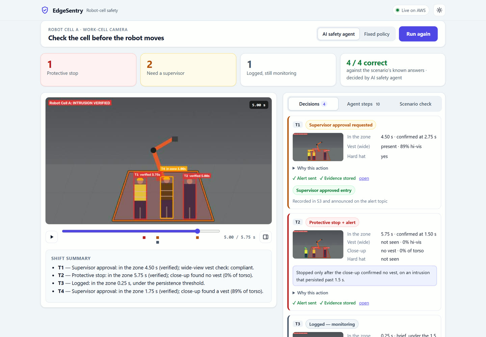
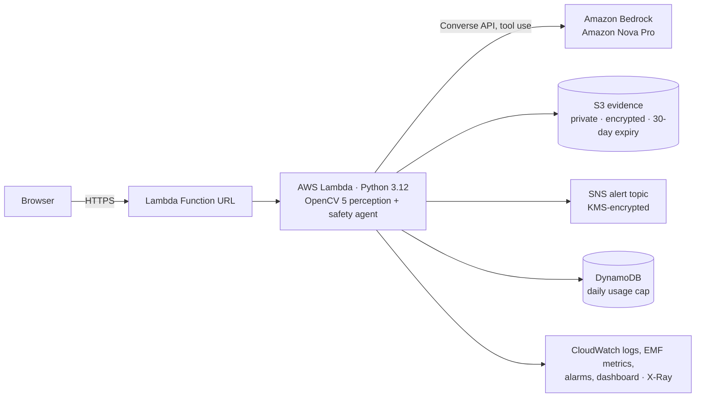
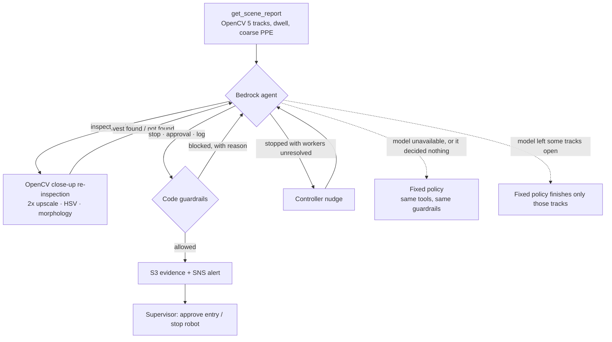

# EdgeSentry — robot-cell safety agent (OpenCV 5 + AWS)

[](https://www.python.org)
[](https://opencv.org)
[](https://aws.amazon.com)
[](LICENSE)

> Built for the [OpenCV AI Competition 2026, powered by AWS](https://opencv26.devpost.com/), and entered for the Agentic Vision Award.

EdgeSentry watches the camera over an industrial robot cell and decides what to do about
every person who steps inside the hazard zone: **stop the robot**, **ask a supervisor**, or
**keep monitoring**. OpenCV 5 does the seeing. A tool-using agent on Amazon Bedrock does the
deciding. Code guardrails veto any unsafe or unproven action. Evidence goes to S3, alerts go
to SNS, and a supervisor closes the loop from the browser.

**Live demo:** <https://jzyv7mljhphuteckul2lxqe77u0xbqev.lambda-url.us-east-1.on.aws/> (AWS Lambda, us-east-1; capped daily usage)
**Technical report:** [docs/TECHNICAL_REPORT.md](docs/TECHNICAL_REPORT.md) · **Evaluation data:** [docs/EVALUATION.json](docs/EVALUATION.json) · **Live agent trace:** [docs/TRACE_EXAMPLE.json](docs/TRACE_EXAMPLE.json)



## What happens when you press "Run safety check"

1. **See:** OpenCV 5 compares each frame of a 24-frame camera clip to the empty-cell
   reference (after correcting camera drift and lighting), finds people, splits groups,
   and tracks everyone across frames.
2. **Verify:** an intrusion only counts after 1.5 s inside the zone, and a worker is
   re-inspected up close before any stop is allowed.
3. **Decide:** the Bedrock agent reads the OpenCV scene report, calls the close-up
   inspection tool, and picks an action per worker. Guardrails block anything unsafe, and
   a controller sends the agent back if it leaves anyone unresolved.
4. **Act:** each action stores an evidence frame in S3. Stops and approval requests are
   published to SNS. A supervisor approves the entry or stops the robot from the page.

## Results (all measured; reproduce with `python scripts/evaluate.py`)

| What | Result |
|---|---|
| Bedrock agent, 10 live trials on the reference clip | **10/10 runs fully correct**, 0 false stops, 0 missed stops, 0 fallbacks; median 8.7 s per decision run |
| Guardrails and controller in those trials | 4 unsafe actions **blocked** (logging a verified intrusion); 9/10 runs needed a nudge to resolve a skipped worker |
| Robustness sweep: noise, lighting ±30/+80, camera shift 3–8 px, 1° rotation, 2 fps, grouped/kneeling workers | **16 of 17 variants fully correct.** The 1 failure is a vest at 8% brightness, which fails safe (an unneeded stop, never a missed one) |
| Ablation: no close-up re-inspection | 0.75 accuracy with 1 false stop on the reference clip |
| Ablation: no registration / lighting / group splitting | Misses a stop under lighting +30, camera shift 8 px, +80 lighting, grouped workers and rotation |
| Deployed Lambda (2048 MB), 5 warm runs per mode | OpenCV perception **~49 fps** at 1280×720; fixed policy 0.2 s, Bedrock agent 7.3 s median; 4 evidence frames + 3 alerts per run |

The clip is synthetic, so ground truth is exact. That makes the evaluation reproducible, but
it says nothing about real-world accuracy. See [Limitations](docs/TECHNICAL_REPORT.md#8-limitations).

## Architecture



## Agent loop



## Run it

Python 3.11+.

```bash
pip install -r requirements-dev.txt && pip install -e .
pytest -q                                   # 54 tests, real OpenCV on synthetic frames
python scripts/serve_local.py               # the web app at http://localhost:8080 (offline, fixed policy)
python scripts/evaluate.py                  # robustness sweep + ablations -> docs/EVALUATION.json
python scripts/evaluate.py --bedrock 10     # + live Bedrock agent trials (needs AWS credentials)
```

Deploy to your own AWS account (AWS CLI v2 and Python; no Docker, SAM or CDK needed):

```bash
AWS_REGION=us-east-1 ./infra/deploy.sh                          # builds the Linux package, deploys infra/template.yaml
AWS_REGION=us-east-1 ALERT_EMAIL=you@example.com ./infra/deploy.sh   # optional: email alerts
python scripts/live_check.py <AppUrl> --runs 5                  # measure the deployed endpoint
AWS_REGION=us-east-1 ./infra/teardown.sh                        # delete everything
```

Amazon Bedrock model access for Amazon Nova Pro must be enabled in the account. Without
it, the app still works: the fixed policy decides, and the page says so.

## Repository map

| Path | What it is |
|---|---|
| `edgesentry/detector.py` | Clean-plate detector: phase correlation + ECC registration, lighting compensation, envelope differencing, Otsu, morphology, connected components, head-profile group splitting, close-up PPE inspection |
| `edgesentry/agent.py` | Perception summary, agent tools, guardrails, Bedrock Converse loop with controller, fixed policy, evaluation |
| `edgesentry/service.py`, `lambda_function.py` | Cloud service: S3/SNS delivery, CloudWatch EMF metrics, HTTP API, usage caps, supervisor decisions |
| `edgesentry/web/index.html` | The web app (light/dark, no build step) |
| `edgesentry/synthetic.py` | Industrial-cell scene renderer with exact ground truth |
| `infra/` | CloudFormation template, deploy and teardown scripts |
| `scripts/evaluate.py`, `scripts/live_check.py` | Reproducible evaluation and live-endpoint measurement |
| `legacy-js/` | Earlier Node.js prototype, kept for history. Not part of this submission |

## Responsible use

EdgeSentry is a decision-support and alerting layer. It is **not** a certified safety
function and does not replace guards, light curtains, or safety PLCs (ISO 10218 / ISO 13849).
It never fabricates a stop: every stop needs a verified intrusion plus a close-up confirmation.
It never silently drops presence: unrecognised shapes are treated as people. Faces are not
identified, and evidence frames expire after 30 days. More in the
[technical report](docs/TECHNICAL_REPORT.md#9-responsible-use).

## License

MIT
