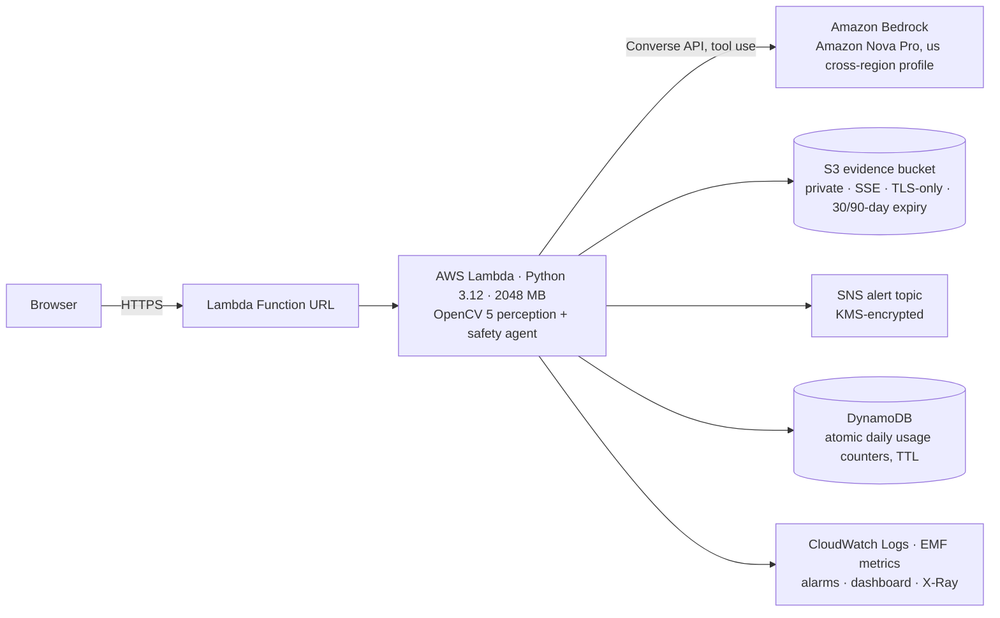
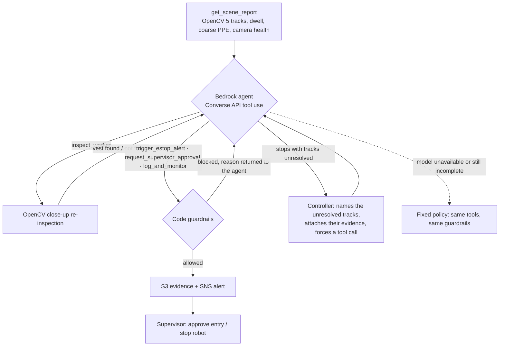

# EdgeSentry: technical report

**OpenCV AI Competition 2026 (powered by AWS)**, entered for the Agentic Vision Award.
Repository: <https://github.com/akmalkhaniub/edgesentry-cv> · Live endpoint: <https://jzyv7mljhphuteckul2lxqe77u0xbqev.lambda-url.us-east-1.on.aws/>

Every number in this report comes from a script in the repository, mainly
`scripts/evaluate.py` (writes `docs/EVALUATION.json`) and `scripts/live_check.py`
(writes `docs/LIVE_CHECK.json`). Nothing is estimated or projected.

---

## 1. Problem and users

Collaborative and industrial robots work inside fenced or painted **work cells**. People
still have to enter them for maintenance, clearing jams, or inspection. Today that is managed
with hard interlocks, which stop everything, and with rules ("wear hi-vis, get a permit")
that cameras could check but usually don't. Generic camera "person detected" alerts fail in
two ways that make operators switch them off:

* **False stops.** A momentary brush of the zone boundary, or a vest in shadow, halts the
  line. Every unneeded stop costs production, so alerts lose trust.
* **Missed context.** Not every entry is a violation. A technician in full PPE doing planned
  maintenance needs a supervisor's acknowledgement, not an emergency stop.

**Users.** Line supervisors and EHS (environment, health and safety) leads at plants with
robot cells. They want three things: stop the robot when someone unprotected is really
inside; ask the supervisor when an entry looks authorised; and leave transient
boundary-brushing alone, with evidence for every decision.

## 2. What EdgeSentry does

A supervisor opens the web app and runs a safety check on the cell camera clip.

1. The page shows the outcome first: protective stops, entries that need a supervisor, and
   entries that were logged.
2. Each decision card shows the evidence frame, how long the person was inside, the
   wide-view and close-up PPE readings, and whether the alert and evidence were delivered.
3. For approval requests, the supervisor clicks **Approve entry** or **Stop the robot**.
   The answer is stored in S3, announced on the alert topic, and only the first answer counts.
4. The **Agent steps** tab shows every tool call the agent made, every guardrail block, and
   every controller nudge. The **Scenario check** tab compares decisions to ground truth.

## 3. Architecture



One Lambda serves the UI and the JSON API (`GET /`, `GET /api/health`, `POST /api/run`,
`POST /api/decision`). The OpenCV work runs inside Lambda, on CPU, with the same code that
runs locally. Infrastructure is a single CloudFormation template (`infra/template.yaml`).

## 4. OpenCV 5 implementation

All perception uses `opencv-python-headless==5.0.0.93`. No trained model is involved; every
stage is a classical OpenCV operation, chosen because a fixed safety camera sees a static
scene, and an empty-scene reference ("clean plate") captured at install time is a strong,
explainable prior. (The headless OpenCV 5 wheel also ships without `HOGDescriptor`.)

| Stage | OpenCV 5 functions | Why |
|---|---|---|
| Camera registration | `phaseCorrelate` (half res, Hanning window from `createHanningWindow`), then `findTransformECC` (quarter res, `MOTION_EUCLIDEAN`, foreground masked) and `computeECC` as an accept/reject guard; `warpAffine` with `WARP_INVERSE_MAP` | Mount vibration or a bump shifts and rotates the view; without correction every edge becomes "foreground" (see ablation) |
| Foreground mask for ECC | `erode`/`dilate` envelopes, `morphologyEx(MORPH_OPEN)`, `dilate` | People must not drive the camera estimate: three bright vests pulled an unmasked ECC to a false 0.9° rotation |
| Illumination compensation | per-channel median offset vs. plate | A global lighting change otherwise swamps the difference image |
| Misalignment-tolerant differencing | `erode`/`dilate` of the plate (5×5), saturating `subtract`/`add` | A pixel counts only if it leaves the plate's local [min, max] envelope, so sub-pixel residuals on hazard stripes do not light up |
| Segmentation | `cvtColor`, `GaussianBlur`, `threshold(THRESH_OTSU)` with a noise floor, `morphologyEx` open/close, `connectedComponentsWithStats` | Standard, fast, explainable |
| Group splitting | silhouette top profile (heads vs. shoulder gaps) | People shoulder to shoulder form one blob. (Convex-hull defects missed a middle head collinear with its neighbours) |
| Fail-safe shapes | — | A large changed region that is not an upright person (kneeling, an object, a group) is **kept** and labelled "unrecognized", never dropped |
| Tracking | centroid tracker (greedy global nearest) | Stable IDs, so persistence is measured per person |
| Zone test | `pointPolygonTest` on the foot point | The hazard zone is painted on the floor |
| Persistence | 1.5 s temporal filter | Kills boundary-brushing and flicker |
| Coarse PPE | `cvtColor(BGR2HSV)`, `inRange` (lit hi-vis needs V ≥ 80) | Cheap screening on every track |
| Close-up re-inspection (agent tool) | `resize(INTER_CUBIC, 2×)`, `inRange` on hue + saturation with low V allowed, `morphologyEx(MORPH_OPEN)`, `connectedComponentsWithStats` (vest must span ≥ 60% of the torso width and cover ≥ 35%) | A vest in shadow fails the coarse check but keeps its chromaticity |
| Overlay | `fillPoly`, `addWeighted`, `polylines`, `rectangle`, `getTextSize`, `putText(LINE_AA)` | Causal overlay: each frame shows only what was known at that instant |

Perception throughput, measured: **~49 fps** at 1280×720 on the deployed Lambda (median of
4 warm runs per mode, 24 frames per run, `docs/LIVE_CHECK.json`). On the development laptop
(Intel Core, 4th generation), about 21–23 fps.

**OpenCV 5 finding.** In `opencv-python-headless 5.0.0.93`, `cv2.phaseCorrelate(src1, src2, window)`
multiplies both input arrays by the window **in place**. Calling it repeatedly against a
stored reference silently erases the reference. EdgeSentry passes copies, and a regression
test (`tests/test_robustness.py::test_plate_is_not_mutated_by_phase_correlation`) pins this.

## 5. Agentic workflow (Agentic Vision Award)



**The agent never sees pixels.** It acts only through tools whose outputs come from OpenCV:

* `get_scene_report`: every track with zone entry, time in zone, persistence-verified flag,
  coarse PPE reading, hard hat, shape, plus camera health.
* `inspect_worker(track_id)`: **active perception**. The close-up re-inspection described
  above. Its result is what decides between a stop and a supervisor call.
* `trigger_estop_alert`, `request_supervisor_approval`, `log_and_monitor`: actions.

**Guardrails are code, not prompt.** They run on every action call, from the model or the
fixed policy:

* a stop requires a **verified** intrusion **and** a prior `inspect_worker` that found **no** vest;
* supervisor approval requires a verified intrusion;
* a verified intrusion may **not** merely be logged (it must be escalated);
* one decision per track; unknown tracks rejected.

A blocked action is returned to the model as a tool error with the reason, so it can correct
itself. The **controller** checks that every zone track was resolved; if the model stops
early, it names the missing tracks with their evidence and forces a tool call (at most two
nudges). If the model is unavailable, errors, or is still incomplete, a deterministic policy
re-runs with fresh tools and the same guardrails, and the UI says so.

**How OpenCV output changes later actions.** From a live run (`docs/TRACE_EXAMPLE.json`,
Amazon Nova Pro, unedited):

| Step | Tool | Result |
|---|---|---|
| 1 | `get_scene_report` | 4 people entered the zone; T2 and T4 read "missing" vest in the wide view |
| 2 | `inspect_worker(T2)` | no vest, 0% of torso |
| 3 | `inspect_worker(T4)` | **vest found, 89% of torso**. The vest was in the robot's shadow |
| 4 | `log_and_monitor(T3)` | executed (0.25 s in the zone, not verified) |
| 5 | `trigger_estop_alert(T2)` | executed (verified, close-up confirms no vest) |
| 6 | `request_supervisor_approval(T4)` | executed. **Step 3 turned a would-be false stop into a supervisor call** |
| 7 | controller | T1 unresolved: nudge |
| 8 | `log_and_monitor(T1)` | **blocked**: "verified intrusions must be escalated (supervisor approval or E-stop), not just logged" |
| 9 | controller | T1 still unresolved: nudge |
| 10 | `request_supervisor_approval(T1)` | executed |

**Human control.** Stops and approval requests go to people (SNS). Approval requests are
answered in the UI (`POST /api/decision`). The answer is accepted only if the agent really made
that request (its evidence object must exist in S3), it is written with an S3 conditional put
(`IfNoneMatch="*"`, first answer wins), and it is published to the alert topic. The headline
shift summary is generated from executed actions and measured evidence, **not** from model
prose. In testing, the model's own closing note once claimed it had sent T3 for approval when
it had logged T3. That note is still shown, collapsed and labelled "not verified".

**Observability.** Every run emits a CloudWatch Embedded Metric Format record: perception ms,
agent ms, agent steps, guardrail blocks, stops, scenario accuracy, fallbacks. These are
dimensioned by decision mode and feed a dashboard and two alarms: Lambda errors, and the
agent falling back 3+ times in 15 minutes. X-Ray tracing is on. The full trace (tool, input,
reasoning text, output) is in every API response and in the UI.

## 6. AWS deployment

`infra/template.yaml` (CloudFormation) creates:

| Resource | Configuration |
|---|---|
| Lambda (`python3.12`, x86_64, 2048 MB, 60 s) | Reserved concurrency 4; X-Ray active; dedicated log group with 14-day retention |
| Lambda Function URL | `AuthType NONE` (public demo). Invoke permissions scoped with `InvokedViaFunctionUrl` |
| S3 evidence bucket | Block all public access, bucket-owner-enforced, SSE-S3, TLS-only bucket policy, lifecycle expiry (evidence 30 days, decisions 90 days); evidence shared only through 1-hour presigned URLs |
| SNS topic | KMS-encrypted (`alias/aws/sns`); optional email subscription parameter |
| DynamoDB table | On-demand, SSE, TTL. Atomic conditional counters cap public usage per UTC day (1,000 checks; 150 AI-agent runs, after which the fixed policy decides and the page says why) |
| IAM role | Least privilege: write/read only `evidence/*` and `decisions/*`, publish to the one topic, update the one table, invoke only `amazon.nova-*` models and profiles, write only its own log group |
| CloudWatch | Errors alarm and agent-fallback alarm (both to SNS), and a dashboard of latency, outcomes, accuracy and Lambda health |

The deploy script builds the package from pinned Linux wheels (`pip --platform
manylinux_2_28_x86_64 --only-binary=:all:`). It strips NumPy's test suites to keep the unzipped
package at 208 MB (Lambda's limit is 250 MB), uploads it to a private, encrypted artifact
bucket, and runs `aws cloudformation deploy`. No Docker, SAM or CDK is needed. `teardown.sh`
removes everything.

**Reproducibility.** Dependencies are pinned (`numpy==2.4.4`, `opencv-python-headless==5.0.0.93`;
dev: `pytest==9.0.3`, `coverage==7.16.1`, `boto3==1.43.118`). The scenario is generated
deterministically, so `scripts/evaluate.py` reproduces every offline number. There are 54
automated tests, with 95% branch coverage on the package and the Lambda handler.

## 7. Evaluation

### 7.1 Method

The reference clip (`edgesentry/synthetic.py`) is a fixed industrial camera view of a robot
cell. It runs 24 frames at 4 fps, 1280×720, with sensor noise, and contains four scripted
people with known correct actions:

| Person | Situation | Correct action |
|---|---|---|
| W-12 | Operator without PPE, inside the cell the whole time | Protective stop |
| W-07 | Technician in full PPE walks in and stays | Supervisor approval |
| W-03 | Passer-by clips the cell corner for about half a second | Log and keep monitoring |
| W-15 | Contractor whose vest is in the robot's shadow | Supervisor approval (a stop here would be a false stop) |

Synthetic data gives exact ground truth and lets us apply controlled stress (noise, light,
camera motion, posture, grouping), each in isolation. Tracks are matched to ground-truth
workers by mean IoU ≥ 0.5. **Decision accuracy** is the fraction of workers given the correct
action. A **false stop** is a stop for a worker who should not be stopped. A **missed stop** is
no stop for a worker who should be. Missed stops are the safety-critical failure; false stops
are the trust-eroding one.

### 7.2 Robustness sweep and ablations (fixed policy; `docs/EVALUATION.json`)

| Variant | What changes | People tracked / present | Accuracy | False stops | Missed stops | Without close-up (acc / false stops) | Without robustness steps (acc / missed stops) |
|---|---|---|---|---|---|---|---|
| `baseline` | Reference clip: 4 workers, 24 frames at 4 fps | 4 / 4 | 1.00 | 0 | 0 | 0.75 / 1 | 1.00 / 0 |
| `noise_seed_1` | Baseline with a different sensor-noise seed | 4 / 4 | 1.00 | 0 | 0 | 0.75 / 1 | 1.00 / 0 |
| `noise_seed_99` | Baseline with a different sensor-noise seed | 4 / 4 | 1.00 | 0 | 0 | 0.75 / 1 | 1.00 / 0 |
| `sensor_noise_8` | Extra Gaussian sensor noise, sigma 8 | 4 / 4 | 1.00 | 0 | 0 | 0.75 / 1 | 1.00 / 0 |
| `sensor_noise_16` | Extra Gaussian sensor noise, sigma 16 | 4 / 4 | 1.00 | 0 | 0 | 0.75 / 1 | 1.00 / 0 |
| `lighting_plus_30` | Scene 30 levels brighter than the clean plate | 4 / 4 | 1.00 | 0 | 0 | 1.00 / 0 | 0.25 / 1 |
| `lighting_minus_30` | Scene 30 levels darker than the clean plate | 4 / 4 | 1.00 | 0 | 0 | 0.75 / 1 | 1.00 / 0 |
| `camera_shift_3px` | Camera bumped 3 px right / 1 px down | 4 / 4 | 1.00 | 0 | 0 | 0.75 / 1 | 1.00 / 0 |
| `camera_shift_8px` | Camera bumped 8 px right / 4 px down | 4 / 4 | 1.00 | 0 | 0 | 0.75 / 1 | 0.00 / 1 |
| `half_frame_rate` | Same script sampled at 2 fps (12 s clip) | 4 / 4 | 1.00 | 0 | 0 | 0.75 / 1 | 1.00 / 0 |
| `deeper_shadow_0.15` | Contractor's vest keeps 15% of its brightness | 4 / 4 | 1.00 | 0 | 0 | 0.75 / 1 | 1.00 / 0 |
| `deeper_shadow_0.08` | Contractor's vest keeps 8% of its brightness | 4 / 4 | **0.75** | **1** | 0 | 0.75 / 1 | 0.75 / 0 |
| `adjacent_workers` | Two workers shoulder to shoulder (blobs merge) | 2 / 2 | 1.00 | 0 | 0 | 1.00 / 0 | 0.00 / 1 |
| `stress_three_in_a_row` | Three workers shoulder to shoulder | 3 / 3 | 1.00 | 0 | 0 | 1.00 / 0 | 0.00 / 1 |
| `stress_lighting_plus_80` | Scene 80 levels brighter (highlights clip) | 4 / 4 | 1.00 | 0 | 0 | 1.00 / 0 | 0.00 / 1 |
| `stress_camera_rotate_1deg` | Camera rotated 1 degree about the image centre | 4 / 4 | 1.00 | 0 | 0 | 0.75 / 1 | 0.50 / 1 |
| `stress_crouching_worker` | Worker kneeling in the cell (wider than tall) | 1 / 1 | 1.00 | 0 | 0 | 1.00 / 0 | 1.00 / 0 |

* **"Without close-up"** replaces the agent's inspection step with the wide-view PPE reading.
  It causes a false stop on the shadowed contractor in 12 of 17 variants.
* **"Without robustness steps"** turns off registration, lighting compensation and group
  splitting. It **misses a stop** in 6 variants (lighting +30 and +80, an 8 px shift, rotation,
  two and three workers in a row). The envelope differencing and fail-safe shapes stay on in
  this ablation, which is why the kneeling worker still passes.
* The sweep found these failure modes first. Registration, lighting compensation,
  foreground-masked ECC and head-profile splitting were each added because a variant failed.

### 7.3 Failure cases

* **Vest at 8% brightness → false stop.** The close-up's chromaticity test needs V ≥ 25. At
  8% of its brightness the vest is effectively black, and EdgeSentry stops the robot. This is
  the fail-safe direction (an unneeded stop, never a missed one), and the supervisor sees
  exactly why in the evidence.
* **The language model skips the uneventful worker.** In 9 of 10 live trials the model
  finished without resolving T1, the compliant technician, and needed a controller nudge.
* **The language model tries the wrong action.** In 4 of those runs it then tried to merely
  log T1, a verified intrusion, and the guardrail blocked it each time.
* **Model narrative drifts from its actions.** One closing note misstated what it did. Hence
  the headline summary is generated from executed actions only.
* **Before the fixes (history):** a 3 px camera bump broke detection entirely (0/4 workers),
  and lighting +30 missed a stop. Unmasked ECC was pulled to a false 0.9° rotation by three
  workers, and convex-hull splitting cut a middle worker in half. All are now regression-tested.

### 7.4 AI agent trials (live Amazon Bedrock; `docs/EVALUATION.json → agent_trials`)

10 runs of the agent on the reference clip, Amazon Nova Pro, temperature 0:

| Metric | Result |
|---|---|
| Runs fully correct | **10 / 10** |
| False stops / missed stops | 0 / 0 |
| Fallbacks to the fixed policy | 0 |
| Guardrail blocks | 4 (all: logging a verified intrusion) |
| Runs needing a controller nudge | 9 |
| Agent latency, median / max | 8.7 s / 12.1 s |

Outside these trials, one live run through the web app (while recording the demo video) fell
back to the fixed policy. Its reason was returned to the browser but not logged server-side at
the time; fallbacks are now logged as structured `agent_fallback` warnings in CloudWatch.

### 7.5 Deployed endpoint (`docs/LIVE_CHECK.json`)

5 runs per mode against the live Function URL, each writing real S3 evidence and SNS alerts:

| | Fixed policy | AI agent (Bedrock) |
|---|---|---|
| Correct runs | 5 / 5 | 5 / 5 |
| OpenCV perception, median (warm) | 496 ms (~48 fps) | 487 ms (~49 fps) |
| Decisions + delivery, median (warm) | 0.22 s | 7.3 s |
| Browser round trip, median (warm) | 2.6 s | 9.6 s |
| Evidence objects / alerts per run | 4 / 3 | 4 / 3 |

## 8. Limitations

* **Synthetic evaluation only.** No real factory footage was available. Real scenes have
  people who look like the background, reflective surfaces, moving equipment, and plates that
  go stale as fixtures move. The plate approach needs a re-captured plate when the empty
  scene changes, and it does not detect someone who never moves *and* matches the plate.
* **2D only.** The zone test uses the foot point in the image. There is no depth, and people
  occluded at the feet (behind machinery) are not handled.
* **Colour-based PPE.** Hi-vis detection is chromaticity-based. Vests in other colours, or
  yellow clothing that is not PPE, will be misread.
* **Clip-based, not streaming.** The demo analyses a 6-second clip per request. A deployment
  would run perception continuously at the edge, with this agent as the escalation layer.
* **Agent latency** of 7–12 s is fine for supervisor workflows, but far too slow for a
  machine stop. That is exactly why stops never depend on the model being fast, and the
  certified safety layer stays in hardware.

## 9. Responsible use

* **Not a safety function.** EdgeSentry is decision support and alerting. It does not replace
  guards, light curtains, safety-rated monitored stops, or safety PLCs (ISO 10218, ISO 13849,
  IEC 62061), and it must not be wired as the only stop path.
* **No stop without proof.** Every stop needs a persistence-verified intrusion and a close-up
  confirmation, enforced in code. A model cannot talk its way past the guardrails.
* **Never ignore presence.** Unrecognised shapes are treated as people. Uncertainty resolves
  toward the safe action.
* **Humans decide entries.** Authorised-looking entries go to a supervisor, not to automation.
  Supervisor answers are recorded, first answer wins, and they are announced.
* **Privacy.** There is no face recognition and no identity tracking: track IDs reset per
  clip. Evidence frames are private, encrypted, shared only by 1-hour links, and expire after
  30 days. A real deployment needs worker notice and consultation, and local legal review.
* **Honest labelling.** When the AI agent did not decide, the UI says the fixed policy did,
  and why. Model output is never presented as verified fact.
* **Cost and abuse controls.** The public endpoint has reserved concurrency and DynamoDB daily
  caps on runs and on AI-agent runs.

## 10. Reproduce

```bash
pip install -r requirements-dev.txt && pip install -e .
pytest -q                                   # 54 tests
python scripts/evaluate.py                  # sweep + ablations (deterministic)
python scripts/evaluate.py --bedrock 10     # live agent trials (AWS credentials, Nova Pro access)
AWS_REGION=us-east-1 ./infra/deploy.sh      # deploy; prints the AppUrl
python scripts/live_check.py <AppUrl> --runs 5
AWS_REGION=us-east-1 ./infra/teardown.sh
```
